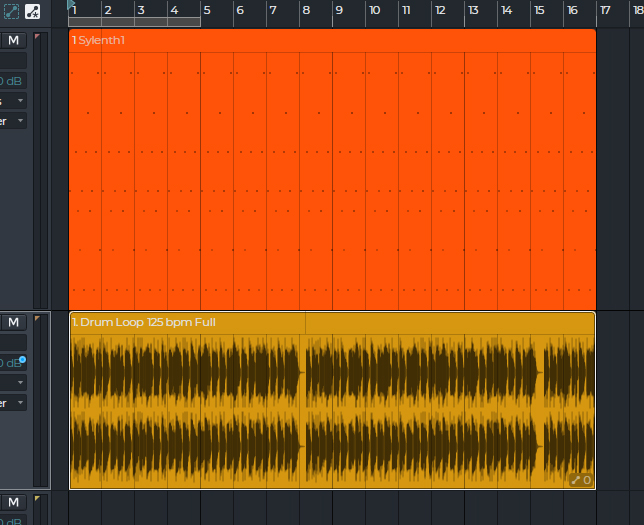
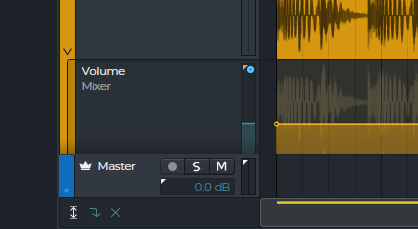
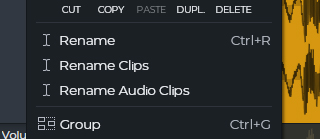
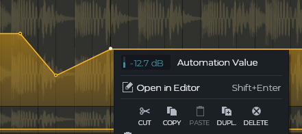
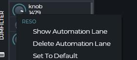
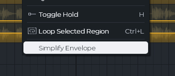
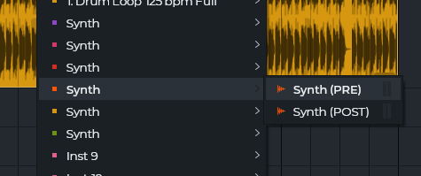
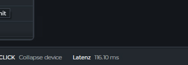

# Bitwig Patchbay Mods

> [!IMPORTANT]
> **Disclaimer:** This tool is an independent, unofficial community project - it has **nothing to do with Bitwig or Bitwig GmbH** and is **not** affiliated with, endorsed by, or created in cooperation with Bitwig GmbH in any way.

A collection of 19 workflow and UI mods for **Bitwig Studio** running on [Patchbay (BML)](https://github.com/shaboogen-dev/Patchbay). Built and tested against **Bitwig Studio 6.1.7** (Windows x64) with Patchbay `0.36.0-dev.14`. Other OS platforms may follow. 

## Install

### Option 1 — Manual download (simplest)

1. Download any mod `.zip` from the [Mod Overview](#mods-overview) below or from [Releases](https://github.com/Mike-8040/bitwig-patchbay-mods/releases).
2. Open **Patchbay** → **Mods → Add Mod…**, select the downloaded `.zip`, and enable it.
3. Launch Bitwig through Patchbay.

### Option 2 — Patchbay Launcher

1. Open [Patchbay Launcher](https://github.com/arius77R/patchbay-launcher).
2. Go to **Sources → Mods → + Add**, enter `Mike-8040/bitwig-patchbay-mods`, and click **Check**.
3. Install and update mods from the **Mods** tab with one click.

> [!NOTE]
> **Framework dependency:** The 5 shortcut-based mods (`Arranger: Expand/Collapse Toggle`, `Arranger: Toggle Play Start Marker via Arranger Selection`, `Browser: Insert Device via Popup Browser`, `Commands: Toggle Spray Can Tool`, `Devices: Collapse/Expand Toggle`) require **Framework: Actions and Menus** (`action-menu-composition-framework` `>= 0.8.0-dev.1`), available from [shaboogen-dev/Mods](https://github.com/shaboogen-dev/Mods) (installed automatically when using Patchbay Launcher).

---

## Mods Overview

| Mod | Description | Requires | Download |
|---|---|---|---|
| Arranger: Expand/Collapse Toggle | Shortcut that collapses or restores selected Arranger groups and row heights in unison | `action-menu-composition-framework` | [`track-expand-collapse-toggle-0.1.0-dev.1.zip`](https://github.com/Mike-8040/bitwig-patchbay-mods/releases/download/v0.1.0/track-expand-collapse-toggle-0.1.0-dev.1.zip) |
| [Arranger: Loop Clip Gradient Removal](#arranger-loop-clip-gradient-removal) | Removes the horizontal overlay gradient on repeated segments of looped clips | — | [`loop-clip-gradient-removal-0.1.0-dev.1.zip`](https://github.com/Mike-8040/bitwig-patchbay-mods/releases/download/v0.1.0/loop-clip-gradient-removal-0.1.0-dev.1.zip) |
| [Arranger: Pin Track](#arranger-pin-track) | Pins selected Arranger tracks/groups at the top or Main at the bottom | — | [`pin-track-0.2.0-dev.3.zip`](https://github.com/Mike-8040/bitwig-patchbay-mods/releases/download/pin-track-0.2.0-dev.3/pin-track-0.2.0-dev.3.zip) |
| [Arranger: Rename Track Clips and Audio Files](#arranger-rename-track-clips-and-audio-files) | Renames Arranger clips and referenced audio files using the track name | — | [`rename-track-clips-and-audio-files-0.1.0-dev.1.zip`](https://github.com/Mike-8040/bitwig-patchbay-mods/releases/download/v0.1.0/rename-track-clips-and-audio-files-0.1.0-dev.1.zip) |
| Arranger: Select Track Content | Adds *Select track content* to the Arranger track header context menu | — | [`select-track-content-0.1.0-dev.1.zip`](https://github.com/Mike-8040/bitwig-patchbay-mods/releases/download/v0.1.0/select-track-content-0.1.0-dev.1.zip) |
| Arranger: Toggle Play Start Marker via Arranger Selection | Shortcut to toggle the *Via the Arranger when selecting* Play Start Marker preference | `action-menu-composition-framework` | [`toggle-play-start-marker-via-arranger-selection-0.1.0-dev.3.zip`](https://github.com/Mike-8040/bitwig-patchbay-mods/releases/download/v0.1.0/toggle-play-start-marker-via-arranger-selection-0.1.0-dev.3.zip) |
| Automation: Point Hitbox | Scales continuous automation point hitboxes with UI scaling and prefers the nearest point | — | [`automation-point-hitbox-0.1.0-dev.1.zip`](https://github.com/Mike-8040/bitwig-patchbay-mods/releases/download/v0.1.0/automation-point-hitbox-0.1.0-dev.1.zip) |
| [Automation: Point Value](#automation-point-value) | Adds an Inspector-style numeric *Automation Value* field to the point context menu | — | [`automation-point-value-0.1.0-dev.2.zip`](https://github.com/Mike-8040/bitwig-patchbay-mods/releases/download/v0.1.0/automation-point-value-0.1.0-dev.2.zip) |
| Automation: Shift Axis Lock | Locks continuous automation point dragging to one axis while holding Shift | — | [`automation-shift-axis-lock-0.1.0-dev.1.zip`](https://github.com/Mike-8040/bitwig-patchbay-mods/releases/download/v0.1.0/automation-shift-axis-lock-0.1.0-dev.1.zip) |
| [Automation: Show Automation Lane](#automation-show-automation-lane) | Adds *Show Automation Lane* to automated device parameter context menus | — | [`show-automation-lane-0.1.0-dev.1.zip`](https://github.com/Mike-8040/bitwig-patchbay-mods/releases/download/v0.1.0/show-automation-lane-0.1.0-dev.1.zip) |
| [Automation: Simplify Envelope](#automation-simplify-envelope) | Reduces redundant points in a selected continuous automation envelope in one undo step | — | [`simplify-envelope-0.1.0-dev.1.zip`](https://github.com/Mike-8040/bitwig-patchbay-mods/releases/download/v0.1.0/simplify-envelope-0.1.0-dev.1.zip) |
| Browser: Insert Device via Popup Browser | Shortcut that opens the native popup browser at the end of the active device chain | `action-menu-composition-framework` | [`insert-device-via-popup-browser-0.1.0-dev.1.zip`](https://github.com/Mike-8040/bitwig-patchbay-mods/releases/download/v0.1.0/insert-device-via-popup-browser-0.1.0-dev.1.zip) |
| Commands: Toggle Spray Can Tool | Shortcut to toggle between the Spray Can Tool and the previously active tool | `action-menu-composition-framework` | [`toggle-spray-can-tool-0.1.0-dev.2.zip`](https://github.com/Mike-8040/bitwig-patchbay-mods/releases/download/v0.1.0/toggle-spray-can-tool-0.1.0-dev.2.zip) |
| [Devices: Active Sidechain Source Highlight](#devices-active-sidechain-source-highlight) | Highlights the active sidechain routing source and its group path in the source menu | — | [`active-sidechain-source-highlight-0.1.0-dev.1.zip`](https://github.com/Mike-8040/bitwig-patchbay-mods/releases/download/v0.1.0/active-sidechain-source-highlight-0.1.0-dev.1.zip) |
| Devices: Collapse/Expand Toggle | Shortcut to fold or unfold all selected devices in the focused device chain | `action-menu-composition-framework` | [`device-collapse-expand-toggle-0.1.0-dev.1.zip`](https://github.com/Mike-8040/bitwig-patchbay-mods/releases/download/v0.1.0/device-collapse-expand-toggle-0.1.0-dev.1.zip) |
| [Devices: Latency on Hover](#devices-latency-on-hover) | Displays a device's cached latency in milliseconds in the footer on hover | — | [`device-latency-on-hover-0.1.0-dev.1.zip`](https://github.com/Mike-8040/bitwig-patchbay-mods/releases/download/v0.1.0/device-latency-on-hover-0.1.0-dev.1.zip) |
| Interface: Dark Theme Notification Details | Uses the active theme's *Light Text* color for notification detail text | — | [`dark-theme-notification-details-0.1.0-dev.1.zip`](https://github.com/Mike-8040/bitwig-patchbay-mods/releases/download/v0.1.0/dark-theme-notification-details-0.1.0-dev.1.zip) |
| Interface: Dark Theme Text Selection | Keeps selected text readable with dark text on the bright selection background | — | [`dark-theme-text-selection-0.1.0-dev.1.zip`](https://github.com/Mike-8040/bitwig-patchbay-mods/releases/download/v0.1.0/dark-theme-text-selection-0.1.0-dev.1.zip) |
| Transport: Plug-in Space for Transport | Routes unmodified Space to Bitwig transport in supported non-editing plug-in windows | — | [`plugin-space-for-transport-0.1.0-dev.1.zip`](https://github.com/Mike-8040/bitwig-patchbay-mods/releases/download/v0.1.0/plugin-space-for-transport-0.1.0-dev.1.zip) |

---

## Visual Showcase

### Arranger: Loop Clip Gradient Removal

Removes the horizontal overlay gradient drawn across repeated loop segments of Arranger clips so looped clip colors stay clean and consistent across the timeline while keeping all standard clip drawing intact.

**Download:** [`loop-clip-gradient-removal-0.1.0-dev.1.zip`](https://github.com/Mike-8040/bitwig-patchbay-mods/releases/download/v0.1.0/loop-clip-gradient-removal-0.1.0-dev.1.zip)

---

### Arranger: Pin Track

Right-click an Arranger track header and choose **Pin in Arranger** or **Unpin from Arranger**. Pinned tracks and groups stay fixed at the top of the Arranger (and Main stays at the bottom), saved per project ID, with full support for Clip Launcher scrolling and drag-and-drop track/device insertion.

**Download:** [`pin-track-0.2.0-dev.3.zip`](https://github.com/Mike-8040/bitwig-patchbay-mods/releases/download/pin-track-0.2.0-dev.3/pin-track-0.2.0-dev.3.zip)

---

### Arranger: Rename Track Clips and Audio Files

Adds **Rename Clips** and **Rename Audio Clips** directly below **Rename** in the Arranger track header context menu. **Rename Clips** applies the track name to its clips, while **Rename Audio Clips** numbers and renames the underlying audio files and updates project references via Bitwig's native rename operation. *(Test on a project copy first before renaming audio files on disk.)*

**Download:** [`rename-track-clips-and-audio-files-0.1.0-dev.1.zip`](https://github.com/Mike-8040/bitwig-patchbay-mods/releases/download/v0.1.0/rename-track-clips-and-audio-files-0.1.0-dev.1.zip)

---

### Automation: Point Value

Adds Bitwig's native Inspector-style **Automation Value** numeric control directly at the top of the continuous automation point context menu, complete with native `dB`, `%`, and `Hz` formatting. Dragging moves all selected points together by the same delta while respecting range boundaries, and typing sets an exact value for the entire selection.

**Download:** [`automation-point-value-0.1.0-dev.2.zip`](https://github.com/Mike-8040/bitwig-patchbay-mods/releases/download/v0.1.0/automation-point-value-0.1.0-dev.2.zip)

---

### Automation: Show Automation Lane

Right-click an automated device parameter and select **Show Automation Lane** directly above **Delete Automation Lane** to immediately reveal its existing automation lane in the Arranger.

**Download:** [`show-automation-lane-0.1.0-dev.1.zip`](https://github.com/Mike-8040/bitwig-patchbay-mods/releases/download/v0.1.0/show-automation-lane-0.1.0-dev.1.zip)

---

### Automation: Simplify Envelope

Select at least three points on a continuous automation envelope and open the point context menu to run **Simplify Envelope**. Redundant points within a 2.5% normalized vertical tolerance are removed as a single Bitwig undo step while preserving endpoints, jumps, and existing curves.

**Download:** [`simplify-envelope-0.1.0-dev.1.zip`](https://github.com/Mike-8040/bitwig-patchbay-mods/releases/download/v0.1.0/simplify-envelope-0.1.0-dev.1.zip)

---

### Devices: Active Sidechain Source Highlight

Open a device's sidechain input menu to see the currently active routing source and its parent group path clearly highlighted using the active theme's **Grey 4** accent and semibold native menu font, resolved by actual routing identity.

**Download:** [`active-sidechain-source-highlight-0.1.0-dev.1.zip`](https://github.com/Mike-8040/bitwig-patchbay-mods/releases/download/v0.1.0/active-sidechain-source-highlight-0.1.0-dev.1.zip)

---

### Devices: Latency on Hover

Hover over any device in the device chain to view its cached latency in milliseconds directly after the mouse hints in Bitwig's native footer bar.

**Download:** [`device-latency-on-hover-0.1.0-dev.1.zip`](https://github.com/Mike-8040/bitwig-patchbay-mods/releases/download/v0.1.0/device-latency-on-hover-0.1.0-dev.1.zip)

